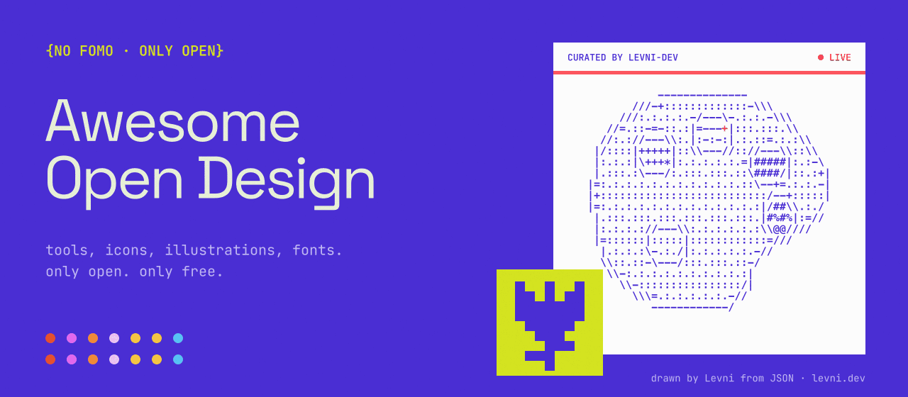

  

**Open-source design tools and openly licensed design resources: editors, icons, illustrations, fonts, colour, creative code. For people and for AI agents.**

[Suggest a project](../../issues/new?template=suggest.yml) · [How we curate](CONTRIBUTING.md) · [More lists](#more-lists-from-levni-dev) · [levni.dev](https://levni.dev)

> Every week a new design tool launches with a waitlist, a free trial and a credit card form. You do not need it. Most of what a designer needs is already open, free and runs on your own machine. This list is that shelf.
>
> **The rule: no FOMO, only open.** Open licence, free to start, alive and useful. No credit card, no paid API key, no waitlist.

## Contents

- [Design & prototyping tools](#design--prototyping-tools)
- [Open illustration libraries](#open-illustration-libraries)
- [Open icon sets](#open-icon-sets)
- [Open fonts & type](#open-fonts--type)
- [Colour & palette tools](#colour--palette-tools)
- [Generative & creative coding](#generative--creative-coding)
- [Design systems & UI kits](#design-systems--ui-kits)
- [Mockups & open assets](#mockups--open-assets)
- [Image processing & export](#image-processing--export)
- [Print, riso & dithering](#print-riso--dithering)
- [Design for agents](#design-for-agents)
- [More lists from Levni-Dev](#more-lists-from-levni-dev)
- [Thanks](#thanks)
- [Made with Levni](#made-with-levni)

## Design & prototyping tools

- [Penpot](https://penpot.app) - Self-hostable vector design and prototyping tool built on SVG and CSS, with real-time collaboration. `MPL-2.0`
- [Inkscape](https://inkscape.org) - Desktop vector editor on native SVG; its command-line mode also exports and converts files in scripts. `GPL-2.0`
- [Krita](https://krita.org) - Painting and illustration app with brush engines, layers and animation, built for artists. `GPL-3.0`
- [GIMP](https://www.gimp.org) - Long-running raster photo editor with layers, masks, filters and a plug-in system. `GPL-3.0`
- [Blender](https://www.blender.org) - 3D modelling, sculpting, rendering and animation suite; also good for product mockups and motion. `GPL-2.0`
- [Excalidraw](https://excalidraw.com) - Hand-drawn style whiteboard that runs in the browser and embeds as a React component. `MIT`
- [Graphite](https://graphite.rs) - Rust-built vector and raster editor with a node-based, non-destructive workflow. `Apache-2.0`
- [draw.io (diagrams.net)](https://www.drawio.com) - Diagram editor that works offline and self-hosts, with a large shape library. `Apache-2.0`
- [Mermaid](https://mermaid.js.org) - Draws flowcharts, sequence and other diagrams from plain text definitions. `MIT`
- [D2](https://d2lang.com) - Declarative diagram language that compiles text into SVG with several layout engines. `MPL-2.0`
- [drawDB](https://www.drawdb.app) - Browser database schema designer that exports SQL, no sign-up needed. `AGPL-3.0`
- [MyPaint](https://mypaint.app) - Lightweight painting app with an infinite canvas and pressure-sensitive brushes. `GPL-2.0`
- [Scribus](https://www.scribus.net) - Desktop publishing for print layouts, with CMYK colour and PDF export. `GPL-2.0`

## Open illustration libraries

- [Open Peeps](https://www.openpeeps.com) - Hand-drawn people library of mix-and-match heads, bodies and poses, by Pablo Stanley. `CC0-1.0`
- [Open Doodles](https://opendoodles.com) - Free sketchy doodle illustrations by Pablo Stanley, usable without credit. `CC0-1.0`
- [Humaaans](https://www.humaaans.com) - Build-your-own flat people illustrations from interchangeable parts; the site now states CC0. `CC0-1.0`
- [Levni Folio](https://levni.dev) - 1,600+ drawings usable as SVG in several style packs; credit "drawings by Ortak Alan". `CC BY 4.0`
- [Hero Patterns](https://heropatterns.com) - Repeatable SVG background patterns with a CSS generator. `CC BY 4.0`
- [OpenMoji](https://www.openmoji.org) - Open-source emoji and icon set drawn on one consistent grid. `CC BY-SA 4.0`
- [Twemoji (community fork)](https://github.com/jdecked/twemoji) - Maintained fork of Twitter's emoji set as SVG and PNG. `MIT + CC BY 4.0`
- [Noto Emoji](https://github.com/googlefonts/noto-emoji) - Google's emoji artwork and colour emoji font sources. `OFL-1.1`

## Open icon sets

- [Lucide](https://lucide.dev) - Community fork of Feather with 1,500+ consistent stroke icons and packages for most frameworks. `ISC`
- [Phosphor Icons](https://phosphoricons.com) - Flexible icon family in six weights, from thin to duotone. `MIT`
- [Tabler Icons](https://tabler.io/icons) - Several thousand editable 24px stroke icons, delivered as SVG, font or React. `MIT`
- [Heroicons](https://heroicons.com) - Hand-crafted SVG icons by the Tailwind team in outline, solid and mini styles. `MIT`
- [Iconoir](https://iconoir.com) - Free icon library of 1,600+ SVG icons with packages for React, Vue and Flutter. `MIT`
- [Iconify](https://iconify.design) - One API and tooling over 200+ open icon sets; each set keeps its own licence. `MIT`
- [Radix Icons](https://icons.radix-ui.com) - Crisp 15x15 icon set made for dense interfaces. `MIT`
- [Bootstrap Icons](https://icons.getbootstrap.com) - 2,000+ SVG icons, usable as sprite, font or inline SVG. `MIT`
- [Material Design Icons](https://fonts.google.com/icons) - Google's Material Symbols and legacy icons as SVG and variable font. `Apache-2.0`
- [Ionicons](https://ionic.io/ionicons) - Outline, filled and sharp icons for web, iOS and Android. `MIT`
- [Simple Icons](https://simpleicons.org) - Single-colour SVG logos of popular brands; brand marks stay trademarks of their owners. `CC0-1.0`
- [game-icons.net](https://game-icons.net) - 4,000+ one-colour icons for games and illustrations, recolourable online. `CC BY 3.0`

## Open fonts & type

- [Google Fonts](https://fonts.google.com) - Large catalogue of web and print fonts, all downloadable and self-hostable. `OFL-1.1`
- [Fontsource](https://fontsource.org) - Open fonts packaged as npm modules for self-hosting without a font CDN. `MIT`
- [The League of Moveable Type](https://www.theleagueofmoveabletype.com) - Small foundry of carefully made open-source typefaces. `OFL-1.1`
- [FontTools](https://github.com/fonttools/fonttools) - Python library and CLI to read, subset, convert and edit font files. `MIT`
- [FontForge](https://fontforge.org) - Font editor for drawing glyphs and generating OpenType and web fonts. `GPL-3.0`

## Colour & palette tools

- [Color.js](https://colorjs.io) - Colour library with CSS Color 4 spaces, OKLCH, gamut mapping and contrast maths. `MIT`
- [chroma.js](https://gka.github.io/chroma.js/) - Small JS library for colour conversion, scales and palette interpolation. `BSD-3-Clause`
- [poline](https://meodai.github.io/poline/) - Generates palettes by walking a line through colour space between anchor points. `MIT`
- [Adobe Leonardo](https://leonardocolor.io) - Builds contrast-targeted colour scales for accessible design systems. `Apache-2.0`
- [Radix Colors](https://www.radix-ui.com/colors) - 12-step colour scales with matching dark mode, designed for UI. `MIT`
- [ColorBrewer](https://colorbrewer2.org) - Classic cartographic palettes, sequential, diverging and qualitative, with colour-blind flags. `Apache-2.0`
- [Catppuccin](https://catppuccin.com) - Pastel colour scheme in four flavours with ports for hundreds of tools. `MIT`
- [color-names](https://github.com/meodai/color-names) - Large list of human-readable colour names, with an API for naming any hex. `MIT`
- [uiGradients](https://uigradients.com) - Curated gradient collection with JSON data and CSS output. `MIT`

## Generative & creative coding

- [p5.js](https://p5js.org) - Processing's friendly JavaScript sketching library for the browser. `LGPL-2.1`
- [Processing](https://processing.org) - The original Java sketchbook for learning to code visual art. `GPL-2.0`
- [three.js](https://threejs.org) - Standard WebGL and WebGPU 3D library for the web. `MIT`
- [Paper.js](http://paperjs.org) - Vector graphics scripting framework on top of canvas, with a clean path API. `MIT`
- [Two.js](https://two.js.org) - Renderer-agnostic 2D drawing API for SVG, canvas and WebGL. `MIT`
- [canvas-sketch](https://github.com/mattdesl/canvas-sketch) - Framework for print-ready generative sketches with hot reload and PNG, SVG and video export. `MIT`
- [OPENRNDR](https://openrndr.org) - Kotlin framework for creative coding, live-coding and real-time graphics. `BSD-2-Clause`
- [nannou](https://nannou.cc) - Creative coding framework for Rust, with Processing-style sketches and GPU rendering. `MIT`
- [NodeBox](https://www.nodebox.net) - Node-based generative design app that outputs vectors. `GPL-2.0`
- [Shader Park](https://shader-park.com) - Write 3D shapes in JavaScript-like code that compiles to GLSL. `MIT`
- [Motion Canvas](https://motioncanvas.io) - Code animated vector graphics in TypeScript with a live editor and video export. `MIT`
- [Lottie Web](https://airbnb.io/lottie/) - Plays After Effects animations exported as JSON in the browser. `MIT`

## Design systems & UI kits

- [Carbon Design System](https://carbondesignsystem.com) - IBM's design system with React and web components, tokens and guidelines. `Apache-2.0`
- [GOV.UK Frontend](https://frontend.design-system.service.gov.uk) - UK government components and styles; code is MIT, the crown logo and font are restricted. `MIT`
- [Primer React](https://primer.style) - GitHub's React component library and design system. `MIT`
- [PatternFly](https://www.patternfly.org) - Red Hat's enterprise design system with components and guidelines. `MIT`
- [shadcn/ui](https://ui.shadcn.com) - Copy-paste React components built on Radix and Tailwind that you own and edit. `MIT`
- [Radix Primitives](https://www.radix-ui.com/primitives) - Unstyled, accessible React building blocks for dialogs, menus and more. `MIT`
- [daisyUI](https://daisyui.com) - Tailwind plugin that adds themed component classes such as btn and card. `MIT`
- [Open Props](https://open-props.style) - Ready-made CSS custom properties for colours, easings, shadows and sizes. `MIT`
- [Material Web](https://github.com/material-components/material-web) - Material 3 components as framework-free web components. `Apache-2.0`
- [Tailwind CSS](https://tailwindcss.com) - Utility-first CSS framework, used here as a design-token base. `MIT`

## Mockups & open assets

- [Poly Haven](https://polyhaven.com) - HDRIs, PBR textures and 3D models for renders and mockups, no sign-up. `CC0-1.0`
- [ambientCG](https://ambientcg.com) - PBR materials, HDRIs and models for 3D scenes and backdrops. `CC0-1.0`
- [Kenney](https://kenney.nl) - Thousands of game and UI sprites, icons and 3D kits. `CC0-1.0`
- [Wikimedia Commons](https://commons.wikimedia.org) - Free media repository; every file shows its own licence, so check before reuse. `Per file`

## Image processing & export

- [sharp](https://sharp.pixelplumbing.com) - Fast Node.js image resizing and conversion built on libvips. `Apache-2.0`
- [Squoosh](https://squoosh.app) - In-browser image compressor with side-by-side codec comparison and a CLI. `Apache-2.0`
- [SVGO](https://svgo.dev) - Node tool that optimises SVG files by stripping metadata and redundant markup. `MIT`
- [libvips](https://www.libvips.org) - Streaming image library that processes large files with low memory. `LGPL-2.1`
- [resvg](https://github.com/linebender/resvg) - Small, accurate SVG renderer that turns SVG into PNG from the CLI or as a library. `Apache-2.0`
- [VTracer](https://www.visioncortex.org/vtracer-docs) - Converts raster images into SVG, including full-colour ones. `MIT`
- [oxipng](https://github.com/shssoichiro/oxipng) - Multithreaded lossless PNG optimiser written in Rust. `MIT`
- [rembg](https://github.com/danielgatis/rembg) - Removes image backgrounds locally via CLI, library or server; model weights carry their own terms. `MIT`
- [libjxl](https://github.com/libjxl/libjxl) - Reference encoder and decoder for JPEG XL. `BSD-3-Clause`
- [FFmpeg](https://ffmpeg.org) - Command-line tool for converting, cutting and filtering video, audio and image sequences. `LGPL-2.1`
- [Satori](https://github.com/vercel/satori) - Turns HTML and CSS into SVG, commonly used to render social cards without a browser. `MPL-2.0`

## Print, riso & dithering

- [riso-colors](https://github.com/mattdesl/riso-colors) - JSON list of risograph ink colours with hex values; old but still the standard reference. `MIT`
- [didder](https://github.com/makew0rld/didder) - Command-line image dithering with many error-diffusion and ordered methods and custom palettes. `GPL-3.0`
- [Image-to-Pixel](https://github.com/Tezumie/Image-to-Pixel) - Editor and JS API that converts images to pixel art with dithering and palette control. `MIT`
- [Ditherista](https://github.com/robertkist/ditherista) - Desktop dithering app for Windows, Linux and macOS with many algorithms. `MIT`
- [dithering-shader](https://github.com/niccolofanton/dithering-shader) - Real-time Bayer dithering post-effect for React Three Fiber scenes. `MIT`
- [riso-windowseat](https://github.com/sevenevesai/riso-windowseat) - Procedural risograph-style animated films, each in a single HTML file. `MIT`
- [mono-color-skill](https://github.com/yanliudesign/mono-color-skill) - Agent skill for one-ink editorial images with halftone photography and warm paper tones. `MIT`
- [Typst](https://typst.app) - Markup-based typesetting system that compiles fast to PDF, an alternative to LaTeX. `Apache-2.0`
- [WeasyPrint](https://weasyprint.org) - Renders HTML and CSS to print-ready PDF without a browser. `BSD-3-Clause`
- [Marp](https://marp.app) - Markdown to slide decks and PDF, with CLI and editor integration. `MIT`
- [Slidev](https://sli.dev) - Developer-oriented slides written in Markdown and Vue, exportable to PDF and PNG. `MIT`

## Design for agents

- [Levni](https://levni.dev) - Design engine for agents: draws covers, icons and posters from JSON, with MCP and CLI, no image model. `MIT + CC BY 4.0`
- [Impeccable](https://github.com/pbakaus/impeccable) - Design vocabulary and commands for coding agents to steer, critique and audit front-end work. `Apache-2.0`
- [Anthropic Agent Skills](https://github.com/anthropics/skills) - Reference skills including frontend-design, canvas-design and algorithmic-art for agents. `Apache-2.0`
- [claude-drawing-skill](https://github.com/cloveric/claude-drawing-skill) - Skill for procedural illustration in 83 styles with numpy and Pillow on CPU, no image model. `MIT`
- [Onlook](https://github.com/onlook-dev/onlook) - Open-source visual editor where you design on a live React app and AI edits the code. `Apache-2.0`
- [Mermaid CLI](https://github.com/mermaid-js/mermaid-cli) - Command-line renderer from Mermaid text to SVG, PNG or PDF, handy for agent output. `MIT`
- [Playwright](https://playwright.dev) - Browser automation that agents use to screenshot HTML designs and check layouts. `Apache-2.0`

## More lists from Levni-Dev

- [Awesome Open Design](https://github.com/Levni-Dev/awesome-open-design) - the hub: tools, icons, illustrations, fonts, colour, creative code. *(you are here)*
- [Awesome Design MCP](https://github.com/Levni-Dev/awesome-design-mcp) - MCP servers that let AI agents design.
- [Awesome Lettering](https://github.com/Levni-Dev/awesome-lettering) - type design, open fonts, lettering and kinetic type.

## Thanks

This list stands on the shoulders of [sindresorhus/awesome](https://github.com/sindresorhus/awesome), the list of awesome lists that started the format. Thank you to every maintainer listed here for making their work open.

## Made with Levni

The banner above was drawn by [Levni](https://levni.dev), an open-source design engine for AI agents, from a few lines of JSON. No image model, no API key. Try it: `claude mcp add levni -- npx -y @levni/levni mcp`

## Contributing

Found something open that belongs here, or made it yourself? [Suggest it](../../issues/new?template=suggest.yml) in one minute, or read [how we curate](CONTRIBUTING.md). Every accepted suggestion is credited.

---

Curated by <a href="https://github.com/Levni-Dev">Levni-Dev</a>, a post-AI center for designers. <a href="https://levni.dev">Levni</a> appears here only as one ordinary entry, the stage belongs to everyone else. No image model was harmed in the making of this list. List released under CC0.

